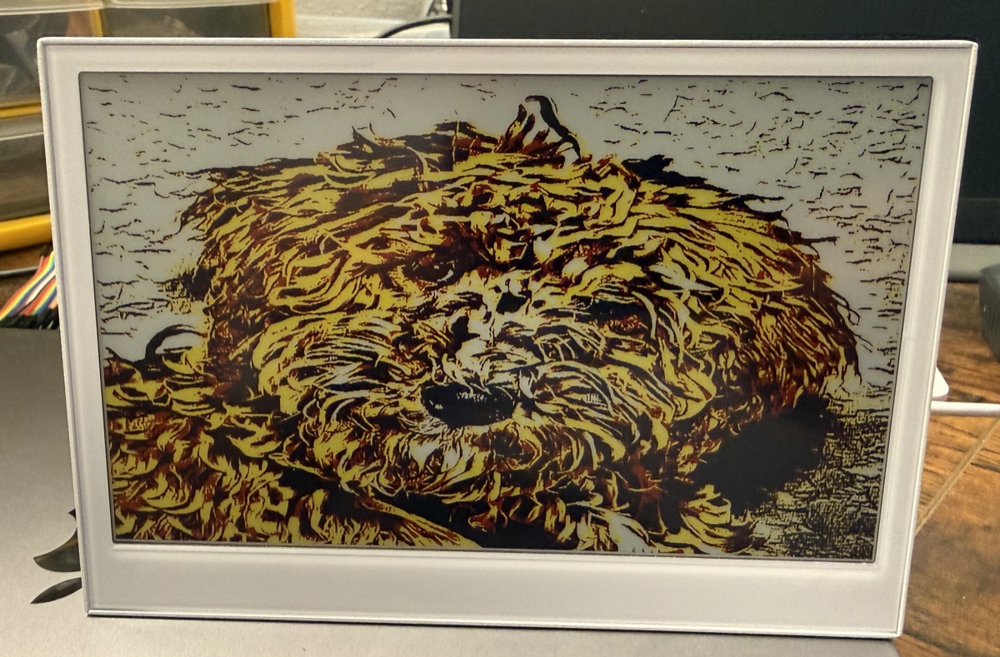
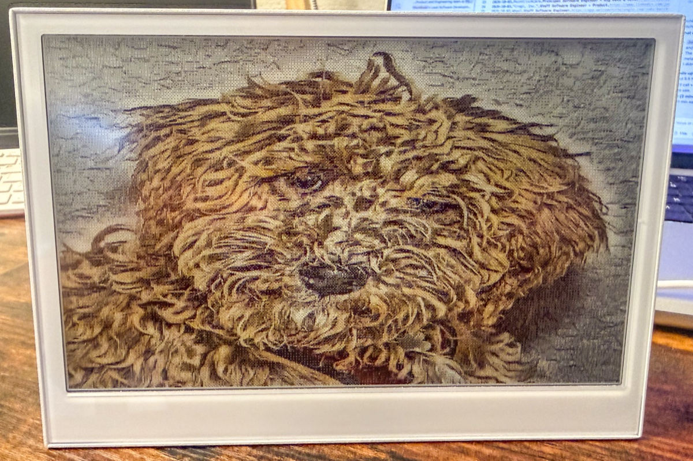
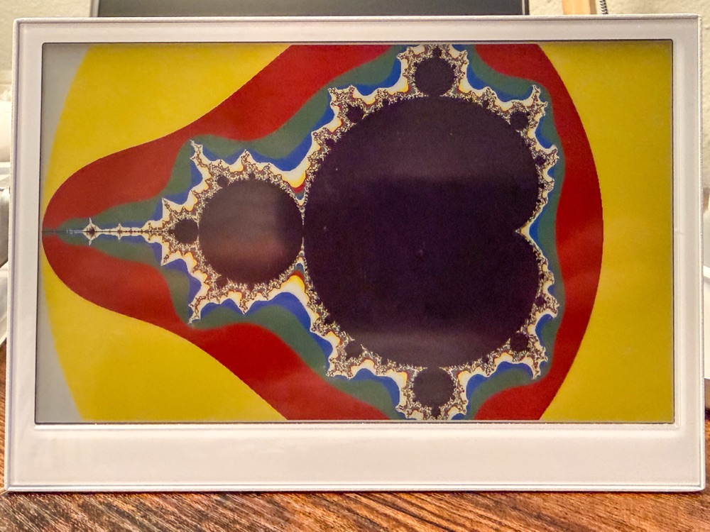
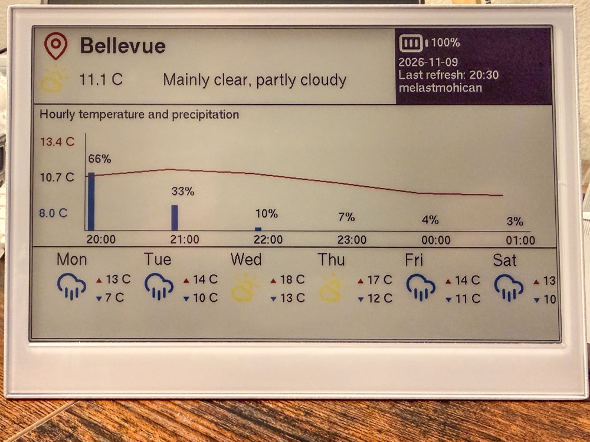

# Rust Embassy Examples for Seeed Studio reTerminal E1002

This repository contains idiomatic Rust examples for the **Seeed Studio reTerminal E1002** carrier board (powered by the **XIAO ESP32-S3** MCU), built using the [Embassy](https://embassy.dev/) async framework, `esp-hal` (v1.1), and `defmt` logging over USB-UART / RTT.

---

## Hardware Overview

- **MCU Board:** Seeed Studio XIAO ESP32-S3
  - **SoC:** ESP32-S3 (Dual-core Xtensa LX7 @ 240 MHz, Wi-Fi 4, Bluetooth 5 LE)
  - **Onboard Peripherals:** User LED, Battery ADC divider, Passive Buzzer, PCF8563 RTC, SHT40 Temp/Humidity Sensor, 3 User Buttons, microSD Card Slot.

### Common Pin Assignments

| Peripheral / Interface | Signal | GPIO Pin | Notes |
|---|---|---|---|
| **I2C Bus (I2C0)** | **SDA** | GPIO19 | Shared bus (RTC & SHT40) |
| | **SCL** | GPIO20 | Shared bus (RTC & SHT40) |
| **SPI Bus (SPI2)** | **SCK** | GPIO7 | Shared bus (microSD & ePaper Display) |
| | **MISO** | GPIO8 | Shared bus (microSD & ePaper Display) |
| | **MOSI** | GPIO9 | Shared bus (microSD & ePaper Display) |
| | **SD CS** | GPIO14 | Active-LOW Chip Select for microSD |
| | **SD Detect** | GPIO15 | Active-LOW Card Detect (`LOW` = Card Present) |
| | **SD Power Enable** | GPIO16 | Active-HIGH Load Switch (`HIGH` = Power ON) |
| **User Inputs** | **KEY0** | GPIO3 | Active-LOW User Button 0 |
| | **KEY1** | GPIO4 | Active-LOW User Button 1 |
| | **KEY2** | GPIO5 | Active-LOW User Button 2 |
| **User Outputs** | **User LED** | GPIO6 | Active-LOW Green LED (`LOW` = ON) |
| | **Buzzer** | GPIO45 | Passive Piezo Buzzer (LEDC PWM) |
| | **Battery ADC** | GPIO1 | ADC1 Channel 0 (1:2 Voltage Divider) |
| | **Battery Enable** | GPIO21 | Active-HIGH Voltage Divider Circuit Enable |
| | **Charger I2C** | GPIO39 (SDA), GPIO40 (SCL) | SY6974B at `0x6B`, own bus |
| **Microphone** | **PDM_EN / CLK / DATA** | GPIO38 / GPIO42 / GPIO41 | MSM261DHP006 PDM MEMS mic |
| **Serial Logging** | **UART1 TX** | GPIO43 | Connected to onboard USB-to-UART bridge |
| | **UART1 RX** | GPIO44 | Connected to onboard USB-to-UART bridge |

---

## Examples

### Power & Analog Examples

#### battery

Reads the Li-Po battery voltage through the onboard 1:2 resistor voltage divider. Drives the active-HIGH enable pin (`GPIO21`) HIGH before sampling ADC1 (`GPIO1`) and LOW afterward to avoid wasting battery current through the divider circuit. The pin is read with the curve-calibrated ADC, which returns millivolts. Without a calibration scheme esp-hal never sets up the ADC reference and a 2 V input reads 4095.

```bash
cargo run --example battery
```

**Wiring Schematic:**

```text
            Seeed Studio reTerminal E1002 Carrier Board
          +-------------------------------------------------+
          | Li-Po Battery Connector (+)                     |
          |       |                                         |
          |       +---[ 100k Ohm ]---+                      |
          |                          |                      |
          |                 GPIO1 (ADC1 CH0)                |
          |                          |                      |
          |       +---[ 100k Ohm ]---+                      |
          |       |                                         |
          |   [ MOSFET Switch ] <--- GPIO21 (Batt Enable)   |
          |       |                                         |
          |      GND                                        |
          +-------------------------------------------------+
```

**About Battery Monitoring:**
The onboard circuit halves the battery voltage before feeding it to ADC pin GPIO1. To calculate true battery voltage:
$$V_{\text{batt}} = 2 \times V_{\text{adc}}$$

---

#### charger

Probes the SY6974B Li-Po charger on its own I2C bus (`GPIO39` SDA, `GPIO40` SCL) at address `0x6B`. Bit 2 of REG08 (`PG`, power good) is 1 on USB and 0 on battery alone, which is the only way to tell them apart: there is no VBUS pin. The user LED blinks the answer every 2 s (once for USB, twice for battery, three times if the charger does not answer), because the serial link is the USB cable. `news` and `weather_station` use the same check (`common::on_usb`) to refresh every 30 minutes on USB and every 120 on battery. The part is in the schematic but not in Seeed's product page.

```bash
cargo run --release --example charger
```

### Button & Input Examples

#### button

Monitors the three user buttons (`KEY0`, `KEY1`, `KEY2`) with time-based debouncing (50ms stability threshold) and logs press and release events via `defmt`.

```bash
cargo run --example button
```

**Pin Mapping:**

```text
            Seeed Studio reTerminal E1002 Carrier Board
          +-------------------------------------------------+
          | 3.3V ---[ Pull-Up ]---+                         |
          |                       |                         |
          |            GPIO3 (KEY0) / GPIO4 (KEY1) / GPIO5 (KEY2)
          |                       |                         |
          |                 [ Tactile Switch ]              |
          |                       |                         |
          |                      GND                        |
          +-------------------------------------------------+
```

---

### Audio & PWM Examples

#### mic

Prints the level of the onboard PDM microphone (MSM261DHP006) every 200 ms: `GPIO38` powers it, `GPIO42` is its clock and `GPIO41` its data. esp-hal 1.1 has no PDM receive mode, so I2S clocks the mic at 2.4 MHz and captures the raw bit stream by DMA, and the example counts the ones per 32-bit word. The level is the peak deviation of a 0.2 ms average from the running mean, x100. Measured on the board: about 7 in a quiet room, 13 to 44 for speech and up to about 1000 for a close clap. It measures loudness, not audio quality.

```bash
cargo run --release --example mic
```

#### buzzer

Drives the onboard passive buzzer on `GPIO45` using ESP32-S3 LEDC hardware PWM. Demonstrates an ascending 3-note startup chime, a double beep, and a low-to-high frequency alert sweep.

```bash
cargo run --example buzzer
```

#### buzzer_tone

Plays the **Imperial March** (Darth Vader theme from Star Wars) using a custom musical score player that supports regular notes, dotted notes, and rests at 120 BPM.

```bash
cargo run --example buzzer_tone
```

---

### User LED Examples

#### led

Controls the onboard user LED on `GPIO6`. Demonstrates digital blinking and smooth brightness fading using LEDC hardware PWM.

```bash
cargo run --example led
```

> **Note on Active-LOW Logic:** Driving `GPIO6` LOW (0% PWM duty) turns the LED **ON**, while driving `GPIO6` HIGH (100% PWM duty) turns the LED **OFF**.

---

### Sensors & I2C Examples

#### rtc

Reads and sets the onboard **PCF8563** Real-Time Clock over I2C (`SDA: GPIO19`, `SCL: GPIO20`). Sets initial date/time at startup and logs the current timestamp every second.

```bash
cargo run --example rtc
```

**About PCF8563:**
The PCF8563 is an ultra-low power CMOS Real-Time Clock / calendar chip from NXP with an I2C slave address of `0x51`.

#### sht4x

Reads temperature (°C) and relative humidity (%RH) from the onboard **Sensirion SHT40** sensor over I2C every 2 seconds.

```bash
cargo run --example sht4x
```

**About Sensirion SHT40:**
- **Temperature Range:** -40°C to +125°C (±0.2°C accuracy)
- **Humidity Range:** 0% to 100% RH (±1.8% RH accuracy)
- **I2C Address:** `0x44`

---

### Storage & SPI Examples

#### sd

Mounts the onboard microSD card slot over SPI2 (`SCK: GPIO7`, `MISO: GPIO8`, `MOSI: GPIO9`, `CS: GPIO14`). Enables slot power (`GPIO16`), verifies card insertion (`GPIO15`), lists root directory contents, and writes/reads `/HELLO.TXT` using the `embedded-sdmmc` crate.

```bash
cargo run --example sd
```

**Pin Mapping (SPI2 / HSPI):**

```text
     reTerminal E1002 Carrier Board          microSD Slot
   +--------------------------------+      +---------------+\
   | GPIO16 (Power Enable, HIGH) ---+----->| VDD           | |
   | GPIO15 (Card Detect, LOW)   <--+------| DET           | |
   | GPIO7  (SPI SCK)  -------------+----->| CLK           | |
   | GPIO8  (SPI MISO) <------------+------| DO            | |
   | GPIO9  (SPI MOSI) -------------+----->| DI            | |
   | GPIO14 (SD CS)    -------------+----->| CS            | |
   +--------------------------------+      +---------------+ /
```

---

### Display & E-Paper Examples

#### epd_ed2208_demo

Comprehensive 6-color e-Paper graphic demonstration for the 7.3" Good Display GDEP073E01 panel (ED2208 controller) using `epdsi` and `embedded-graphics`. Based on the GxEPD2 Demo Arduino sketch for Seeed Studio reTerminal E1002.

Sequences through 6 distinct screens rendered using `embedded-graphics` primitives, fonts, and custom color targets:
1. **Splash Screen:** Titles, subtitle banners, blue horizontal accent divider, top & bottom 6-color stripes.
2. **Color Palette:** 6 native color swatches (Black, White, Red, Green, Blue, Yellow), 5 background/foreground contrast tiles, 5 full-width horizontal color bars.
3. **Color Typography:** Multi-color large text, yellow/red highlight messages, white text on colored badge rects, dark card containing multi-color text lines.
4. **Color Geometry:** Cascading colored rectangles, filled colored circles, triangles, 5-ring Olympic circles, 2x3 swatch grid, concentric circles.
5. **Color Patterns:** 4 pattern boxes (Color Check, H-Stripes, V-Stripes, Color Dots) and a stacked color bar sequence.
6. **Dashboard:** Status metric cards (Temp, Humidity, Heap, Uptime), activity log with colored dot indicators, multi-color progress bar with 100% indicator.

```bash
cargo run --release --example epd_ed2208_demo
```

#### epd_ed2208_deghost

Isolates `epdsi`'s `EpdDriver::de_ghost()` (a clean-sweep refresh ported from `Adafruit_ACEP::deGhost()`) as a before/after comparison on the 7.3" Good Display GDEP073E01 panel.

A uniform full-panel color swap gives ghosting nothing to leave a trace of, so this writes a bold 6-color vertical-bar pattern, then swaps straight to blank white and refreshes again. The blank screen is the one to inspect, for a faint outline of the bars. Runs two pattern-to-blank cycles twice: once with plain refreshes, once with `de_ghost()` called between the pattern and the blank. Compare each blank against the matching one in the other phase.

```bash
cargo run --release --example epd_ed2208_deghost
```

#### epd_ed2208_partial_refresh

Demonstrates `epdsi`'s `Ed2208Controller::trigger_partial_refresh()`: refreshes only a caller-given window instead of always widening to the full panel, on the 7.3" Good Display GDEP073E01 panel.

Fills the panel blue, then cycles a 200x100 window through Red, Green, Yellow, White, and Black, each one via a partial refresh. A final plain `refresh()` with the window still black shows the contrast against a full-panel update.

**Bench-confirmed real limitation:** the blue background outside the window visibly fades starting from the very first partial refresh, not after many repeated ones. This is why Zephyr's own `ed2208_gca` driver refuses to do partial refresh at all. Follow any partial refresh with a prompt full one; don't chain them expecting the untouched area to hold. No speed benefit either way: full and partial refresh both take the same ~30-35s on this controller.

```bash
cargo run --release --example epd_ed2208_partial_refresh
```

#### epd_ed2208_partial_alignment

Bench test for `epdsi`'s backlog item `ed2208-partial-window-alignment` on the 7.3" GDEP073E01 panel. A Zephyr PR claims a partial window must start and end on a multiple of 4 px, because the controller reads an even number of bytes per row. `epdsi` 0.9.3 and earlier accepted any even `x` and `w`.

Fills the panel yellow, then writes three 24-row bands of black and white vertical stripes with a partial refresh each: `x=4 w=386` (193 bytes per row), `x=4 w=388` (194 bytes, the control), and `x=2 w=388`. A sheared window shows slanted or broken stripes. Takes about two minutes; photograph the panel after each band.

**Bench result (22 Oct 2026):** `x=4 w=386` and `x=2 w=388` sheared, `x=4 w=388` was clean. `epdsi` releases after 0.9.3 reject the two sheared windows, so pin `epdsi` to 0.9.3 or earlier to reproduce.

```bash
cargo run --release --example epd_ed2208_partial_alignment
```

#### epd_ed2208_refresh_speed

Shows `Ed2208Controller::with_refresh_speed` on the 7.3" GDEP073E01 panel. The setting picks the PLL control register value that `init` writes, trading colour for refresh time. It needs an `epdsi` release that has `Ed2208RefreshSpeed` (after 0.10.2).

Draws a six-bar swatch (black, white, yellow, red, blue, green) at `Normal`, `Medium` and `Fast`, then at `Normal` again as a control, and logs the refresh time of each stage. Each result holds for 10 seconds. The whole run takes about two minutes.

**Bench result (10 Nov 2026):** `Normal` 28.4 s, `Medium` 21.9 s, `Fast` 14.3 s, control 28.4 s. Blue and green wash out as the speed goes up, clearly so at `Fast`.

Power-cycle the board before each run. The example puts the panel to sleep when it finishes, and a reset or reflash does not wake it: the refreshes then return in about 1 ms and draw nothing.

```bash
cargo run --release --example epd_ed2208_refresh_speed
```

#### epd_ed2208_bmp

Displays 24-bit or 32-bit uncompressed BMP images from a microSD card on the 7.3" Good Display GDEP073E01 6-Color ACeP panel using the local `epdsi` driver library (`Ed2208Controller`).

- **Shared SPI Bus:** Shares SPI2 (`SCK: GPIO7`, `MISO: GPIO8`, `MOSI: GPIO9`) between microSD (`CS: GPIO14`) and EPD (`CS: GPIO10`, `DC: GPIO11`, `RES: GPIO12`, `BUSY: GPIO13`) via `embedded_hal_bus::spi::RefCellDevice`.
- **Nearest Color Quantization:** Quantizes image RGB pixels to the 6 native panel colors (Black, White, Yellow, Red, Blue, Green) using nearest Euclidean distance.
- **Fallback Test Pattern:** Generates a 6-color stripe test pattern if no SD card or matching BMP image is found.

```bash
cargo run --release --example epd_ed2208_bmp
```




#### epd_ed2208_dither

Exercises `epdsi`'s Bayer ordered dithering (`graphics::dither::dither_seven`) on the 7.3" Good Display GDEP073E01 Spectra 6 panel.

Renders six 80 px bands, each a smooth 800 px ramp: black to white, black to red, black to green, black to blue, black to yellow, and a full-saturation hue sweep. Every pixel is quantized to the six native colors with a 4x4 Bayer matrix, with no line buffer and no heap beyond the 192,000 byte packed frame. Judge the dot structure, not color accuracy: the palette is ideal primaries, and real Spectra 6 inks are more muted. Bench-confirmed on the reTerminal E1002: the ramps show a regular fine dot grid with no stripes or seams, and the colors come out duller than on a monitor.

Needs `epdsi` 0.6.2 or later with the `graphics` feature, which is not enabled by default here. `Cargo.toml` enables it.

```bash
cargo run --release --example epd_ed2208_dither
```

#### epd_ed2208_bmp_dither

Same pipeline as `epd_ed2208_bmp`, but each pixel goes through `epdsi`'s Bayer ordered dithering (`graphics::dither::dither_seven`) instead of nearest-color snapping.

It reads `DITHER.BMP` only, so it never overwrites or silently dithers the `IMAGE.BMP` that `epd_ed2208_bmp` uses. It needs a full-color BMP: copy `images/image_fullcolor.bmp` to the card as `DITHER.BMP`, or make your own:

```bash
python3 convert_image.py images/mocha800x480.jpg /Volumes/SD/DITHER.BMP --no-quantize
```

For an A/B, keep the existing `IMAGE.BMP` (`images/image.bmp`, the nearest-quantized rendition of the same photo) on the card, run `epd_ed2208_bmp`, then run this one. With no `DITHER.BMP` it dithers the same six gradient bands as `epd_ed2208_dither`.

**SD card file names:** the SD reader only understands 8.3 short names. Use all-uppercase or all-lowercase, 8 characters or fewer, no spaces. macOS stores a mixed-case name such as `DITHER.bmp` as a long name with a generated short name (`DITHE~19.BMP`), and the example then reports "Falling back to gradient bands" even though the file is on the card. Fix a bad name with `mv DITHER.bmp tmp.bmp && mv tmp.bmp DITHER.BMP`, then `dot_clean` the card. This applies to `epd_ed2208_bmp` too.

**Bench result (reTerminal E1002, 9 Oct 2026):** on the mocha photo, nearest-color snapping posterizes the image into flat yellow, dark red, black and white patches and loses the mid-tones and fine fur detail. Dithering keeps the tonal range and detail, so the photo still reads as the same photo. The cost is color: the dithered result is duller and browner than the source, and less saturated than the nearest-color version. That is expected, because the palette is ideal primaries (pure `255,255,0` yellow and so on) while real Spectra 6 inks are more muted, and there is no gamma handling. For photos the dithered result is the better one; nearest-color only wins on flat graphics. A palette calibrated to measured ink colors would bring saturation back, but `epdsi` does not provide one.



```bash
cargo run --release --example epd_ed2208_bmp_dither
```

#### Image Conversion Tool (`convert_image.py`)

A Python helper script is provided in the repository root to convert any input photo or image (JPG, PNG, WEBP, etc.) into an uncompressed 800x480 BMP formatted for the reTerminal E1002 microSD card:

```bash
# Basic conversion: resizes to 800x480 and quantizes to 6 e-ink colors
python3 convert_image.py images/mocha800x480.jpg /Volumes/SD/IMAGE.BMP

# Show on-screen preview of quantized e-ink colors
python3 convert_image.py images/mocha800x480.jpg --preview
```

Included sample images in `./images/`:
- `epd_ed2208_bmp.jpg`: Photo demonstration of the reTerminal E1002 displaying a 6-color BMP image on the 7.3" EPD panel.
- `image.bmp` / `image_preview.png`: Pre-converted 800x480 6-color sample BMP image.
- `dither.jpg`: Photo of the reTerminal E1002 showing the mocha photo dithered by `epd_ed2208_bmp_dither`.
- `image_fullcolor.bmp`: The same photo as `image.bmp`, resized but not quantized (about 90,000 distinct colors). Copy to the SD card as `DITHER.BMP` for `epd_ed2208_bmp_dither`.
- `mocha800x480.jpg` / `mocha800x480_preview.png`: Sample source photo and 6-color e-ink preview.


---

### Wi-Fi & Generative Display Examples

Ports of the GxEPD2 sketches for the reTerminal E1002, sharing `examples/common/` (panel, frame buffer in PSRAM, text, Wi-Fi/SNTP/HTTPS). `mandelbrot` and `quotables` run once and stop; reset to redraw. `news` and `weather_station` retry a failed request 3 times (each gives up after 30 s), then wait awake with Wi-Fi off and reset themselves every 30 minutes on USB and every 120 on battery, which they tell apart through the charger (10 after a failure, keeping the last good picture). They do not deep-sleep: see the `epd_ed2208_wake` bench on the `troubleshooting` branch (see "Troubleshooting examples" below). A full refresh takes about 30 s. The fonts are `u8g2` bitmap fonts of about the sketches' sizes, so the italic faces are upright.

**Known limitation:** after a cold start of the whole board (the back switch off for 15 s or more, then on), the first draw can show brown and yellow noise instead of the picture, until the next refresh. It was seen on battery and on USB, with these examples and with the Arduino GxEPD2 sketch, so it is not specific to the Rust code. It is intermittent, and it is not caused by Wi-Fi, PSRAM, the SPI speed or the battery voltage. Run on USB power for now. The bench examples for it, `power_probe` and `cold_start_bars`, are on the `troubleshooting` branch.

Wi-Fi credentials (and the NewsAPI key) live in `secret.rs`, which is git-ignored. Copy the template and edit it:

```bash
cp secret.rs.example secret.rs
cargo run --release --example quotables
```

The examples will not build without `secret.rs`; CI copies the placeholder. The hardware-free code (parsing, mappings, drawing) is tested on the host with `./host-tests/run.sh`.

#### mandelbrot

The whole Mandelbrot set, computed in `f32` straight into the frame buffer: black inside, white/yellow/red/green/blue bands by escape time. No Wi-Fi. Edit `CENTER_X`, `CENTER_Y` and `RANGE_X` to zoom.

```bash
cargo run --release --example mandelbrot
```

#### quotables

A random quote from `api.quotable.kurokeita.dev`: red opening quote mark, the quote in black, the author in blue. Quotes over 128 bytes are skipped, up to 10 tries.

```bash
cargo run --release --example quotables
```

#### news

Top headlines from NewsAPI (free key from <https://newsapi.org/>), three articles with a blue headline and a description, plus the date and update time from SNTP (`TIME_ZONE`, default UTC-8).

```bash
cargo run --release --example news
```

#### weather_station

Open-Meteo dashboard (no key): current weather, battery level (GPIO1/GPIO21), a six-hour temperature and rain-chance graph, and a six-day strip. Set `CITY`, `LATITUDE`, `LONGITUDE`, `USERNAME` and `METRIC_UNITS` in the file. Icons are Lucide (ISC, `assets/LICENSE-lucide.txt`).

```bash
cargo run --release --example weather_station
```

---

## Troubleshooting examples

Bench and A/B examples written to chase specific faults are kept on the [`troubleshooting`](https://github.com/melastmohican/rust-reterminal-e1002-examples/tree/troubleshooting) branch, so they do not clutter `main`:

| Example | What it was for |
| --- | --- |
| `epd_ed2208_wake` | the sleep-then-Wi-Fi panel noise (esp-hal deep or light sleep, then Wi-Fi) |
| `power_probe` | the cold-start and battery-boot noise: reset reason, stage, battery voltage and refresh time on the LED |
| `cold_start_bars` | a cold-start test with an Arduino twin (GxEPD2) |
| `epd_ed2208_pll` | refresh speed against the PLL setting |
| `epd_ed2208_fast_init` | the vendor `EPD_init_fast` against the normal init |
| `epd_ed2208_power_cycle` | a per-refresh power cycle against power-on once |

```bash
git checkout troubleshooting
cargo run --release --example epd_ed2208_wake
```

## License

Dual-licensed under either of:
- Apache License, Version 2.0 ([LICENSE-APACHE](LICENSE-APACHE) or <http://www.apache.org/licenses/LICENSE-2.0>)
- MIT license ([LICENSE-MIT](LICENSE-MIT) or <http://opensource.org/licenses/MIT>)
at your option.
